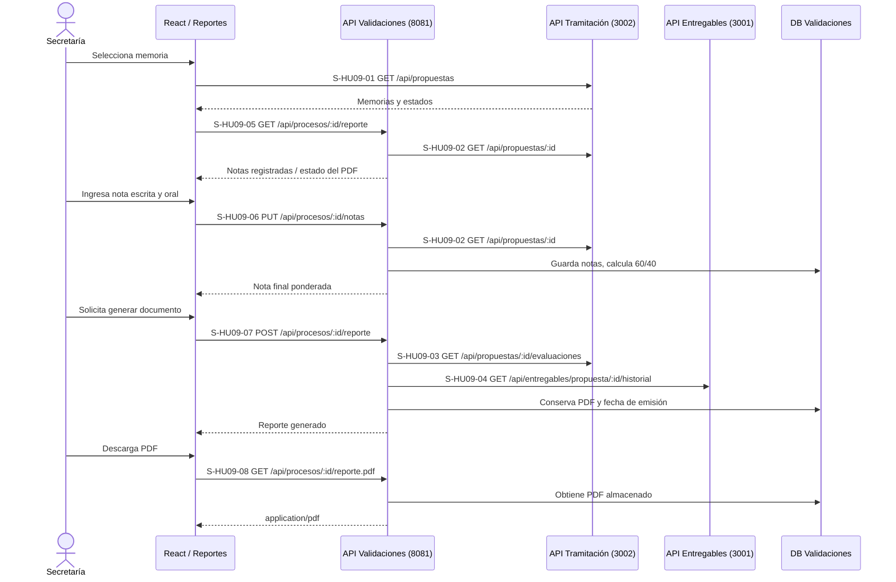

# Servicios — aporte HU-09 (Hito 4)

**Historia asociada:** HU-09 — Generar reporte de estado. **Issue:** #10. **Funcionalidad:** F-03, Evaluación final y cierre.

Esta página cubre únicamente los servicios que agregamos o utilizamos para HU-09. La Wiki del grupo debe integrar estas fichas en su página **Servicios**, junto a los servicios de los demás escenarios prototipados de Hito 3. Los roles se simulan en el prototipo: `X-Demo-Role` **no equivale a autenticación real**.

## Tabla resumen

| ID | Servicio (negocio) | Método | Ruta | HU(s) | Estado |
|---|---|---|---|---|---|
| S-HU09-01 | Listar memorias | GET | `/api/propuestas` | HU-01, HU-09 | Implementado (existente) |
| S-HU09-02 | Consultar una memoria | GET | `/api/propuestas/:propuesta_id` | HU-01, HU-09 | Implementado (existente) |
| S-HU09-03 | Consultar evaluaciones de la propuesta | GET | `/api/propuestas/:propuesta_id/evaluaciones` | HU-09 | Implementado (lectura) |
| S-HU09-04 | Consultar historial de entregables | GET | `/api/entregables/propuesta/:propuesta_id/historial` | HU-09 | Implementado (lectura) |
| S-HU09-05 | Consultar estado del reporte | GET | `/api/procesos/:propuesta_id/reporte` | HU-09 | Implementado |
| S-HU09-06 | Registrar calificaciones | PUT | `/api/procesos/:propuesta_id/notas` | HU-09 | Implementado |
| S-HU09-07 | Generar reporte consolidado | POST | `/api/procesos/:propuesta_id/reporte` | HU-09 | Implementado |
| S-HU09-08 | Descargar reporte emitido | GET | `/api/procesos/:propuesta_id/reporte.pdf` | HU-09 | Implementado |
| S-HU09-09 | Verificar rechazo del cierre solicitado por Secretaría | PATCH | `/api/procesos/:propuesta_id/estado` | HU-09 | Implementado: rechazo sin mutación |

Los servicios S-HU09-01 a S-HU09-02 pertenecen al módulo de tramitación existente y se **reutilizan**, sin duplicar implementaciones. Los servicios S-HU09-03 y 04 agregan únicamente consultas de lectura en los microservicios respectivos.

## Fichas de servicios

### S-HU09-01 — Listar memorias

- **HU / paso:** HU-09, elección de la memoria a reportar.
- **Método y ruta:** `GET /api/propuestas` (API Tramitación, puerto 3002).
- **Propósito:** Mostrar memorias disponibles con sus antecedentes y estado.
- **Entrada:** sin cuerpo; parámetros de consulta: ninguno.
- **Salida 200:** arreglo de propuestas, cada una con `id`, `titulo`, `memorista`, `profesor`, `estado` y otros antecedentes.
- **Códigos:** 200 éxito; 500 consulta de BD fallida.
- **Roles:** consulta disponible en el prototipo para todos los roles; Secretaría la utiliza.
- **Estado:** Implementado (preexistente).

### S-HU09-02 — Consultar una memoria

- **HU / paso:** HU-09, verificar estado de la propuesta antes de modificar notas o generar PDF.
- **Método y ruta:** `GET /api/propuestas/:propuesta_id` (3002).
- **Entrada:** `propuesta_id`, identificador positivo obligatorio en URL.
- **Salida 200:** objeto con `id`, `titulo`, `memorista`, `profesor`, `estado` y antecedentes.
- **Códigos:** 200 éxito, 404 inexistente, 500 error de consulta.
- **Roles:** consulta disponible en el prototipo.
- **Estado:** Implementado (preexistente).

### S-HU09-03 — Consultar evaluaciones de una propuesta

- **HU / paso:** HU-09, consolidación del historial académico.
- **Método y ruta:** `GET /api/propuestas/:propuesta_id/evaluaciones` (3002).
- **Propósito:** Recuperar evaluaciones anteriores de la propuesta para incorporarlas al documento.
- **Entrada:** `propuesta_id` positivo obligatorio en URL.
- **Salida 200:** `[{ "evaluador_nombre": "Docente", "nota": 85, "comentarios": "Revisión aprobada", "fecha_evaluacion": "2026-11-03T10:00:00Z" }]`.
- **Códigos:** 200 éxito (arreglo vacío si no existen evaluaciones), 400 identificador inválido, 404 propuesta inexistente, 500 error de BD.
- **Roles:** consulta interna de HU-09; no se implementa autenticación real en el prototipo.
- **Estado:** Implementado.

### S-HU09-04 — Consultar historial de entregables

- **HU / paso:** HU-09, consolidación de entregables y evaluaciones.
- **Método y ruta:** `GET /api/entregables/propuesta/:propuesta_id/historial` (3001).
- **Propósito:** Consultar avances y evaluaciones asociadas a una memoria, sin modificarlas.
- **Entrada:** `propuesta_id` positivo obligatorio en URL.
- **Salida 200:** `[{ "id": 2, "etapa": "TT1", "estado": "Aprobado", "nombre_archivo": "avance.pdf", "evaluaciones": [{ "evaluador_nombre": "Docente", "nota": 80, "comentarios": "Cumple" }] }]`.
- **Códigos:** 200 éxito (arreglo vacío si no hay entregables), 400 ID inválido, 500 error de BD.
- **Roles:** consulta interna de HU-09; sin autenticación real.
- **Estado:** Implementado.

### S-HU09-05 — Consultar estado de reporte

- **HU / paso:** HU-09, visualizar las notas registradas y verificar si existe PDF.
- **Método y ruta:** `GET /api/procesos/:propuesta_id/reporte` (8081 o proxy Vite).
- **Entrada:** `propuesta_id` entero positivo obligatorio.
- **Salida 200:** `{ "propuesta_id": 4, "nota_escrita": 85, "nota_oral": 90, "nota_final": 87, "reporte_generado": true, "pdf_conservado": true, "ponderacion": { "escrita": 60, "oral": 40 } }`.
- **Códigos:** 200 éxito, 400 ID inválido, 404 propuesta inexistente, 502 servicio Tramitación no disponible, 500 error interno.
- **Roles:** lectura permitida en prototipo.
- **Estado:** Implementado.

### S-HU09-06 — Registrar calificaciones

- **HU / paso:** HU-09, ingreso de notas oral y escrita y cálculo ponderado.
- **Método y ruta:** `PUT /api/procesos/:propuesta_id/notas` (8081).
- **Propósito:** Guardar ambas calificaciones solo si la memoria está Habilitada para Defensa; recalcular automáticamente la nota final e invalidar cualquier reporte anterior.
- **Roles:** Secretaría (`X-Demo-Role: secretaria` en modo simulación de rol).
- **Entrada:** `propuesta_id` entero positivo; JSON obligatorio `{ "nota_escrita": 85, "nota_oral": 90 }`. Las notas son enteros de 0 a 100.
- **Salida 200:** `{ "propuesta_id": 4, "nota_escrita": 85, "nota_oral": 90, "nota_final": 87, "reporte_generado": false, "pdf_conservado": false, "ponderacion": { "escrita": 60, "oral": 40 } }`.
- **Códigos:** 200 éxito, 400 datos inválidos, 403 rol incorrecto, 404 memoria inexistente, 409 estado no habilitado, 502 dependencias inaccesibles, 500 error interno.
- **Estado:** Implementado.

### S-HU09-07 — Generar reporte consolidado

- **HU / paso:** HU-09, emisión de documento final con historial académico.
- **Método y ruta:** `POST /api/procesos/:propuesta_id/reporte` (8081).
- **Propósito:** Emitir y conservar un PDF con antecedentes, notas ponderadas, evaluaciones y entregables disponibles.
- **Roles:** Secretaría (`X-Demo-Role: secretaria` en simulador de rol).
- **Entrada:** `propuesta_id` entero positivo; sin cuerpo; requiere notas guardadas y estado Habilitado para Defensa.
- **Salida 200:** igual que S-HU09-05 con `reporte_generado: true` y `pdf_conservado: true`.
- **Códigos:** 200 éxito, 400 ID inválido, 403 rol incorrecto, 404 memoria inexistente, 409 notas faltantes/estado incorrecto/nota modificada durante emisión, 502 error de integración, 500 error de PDF o BD.
- **Estado:** Implementado.

### S-HU09-08 — Descargar reporte PDF

- **HU / paso:** HU-09, consulta o descarga del documento consolidado.
- **Método y ruta:** `GET /api/procesos/:propuesta_id/reporte.pdf` (8081).
- **Propósito:** Entregar sin recalcular el documento emitido previamente por Secretaría.
- **Entrada:** `propuesta_id` entero positivo, sin cuerpo.
- **Salida 200:** bytes `application/pdf`, archivo `reporte-memoria-ID.pdf`.
- **Códigos:** 200 PDF disponible, 400 ID inválido, 404 memoria inexistente/PDF no generado, 502 error de consulta, 500 error interno.
- **Roles:** lectura en prototipo; la autorización de descargas queda pendiente de autenticación.
- **Estado:** Implementado.

### S-HU09-09 — Comprobar restricción de cierre (criterio 3)

- **HU / paso:** HU-09, Secretaría intenta cambiar el estado de una memoria a `Cerrado`.
- **Método y ruta:** `PATCH /api/procesos/:propuesta_id/estado` (API Validaciones, puerto 8081).
- **Entrada:** cabecera de rol simulado `X-Demo-Role: secretaria` y JSON `{ "estado": "Cerrado" }`.
- **Salida 403:** `{ "error": "No autorizado: solo el Jefe de Carrera puede cambiar la memoria al estado Cerrado.", "codigo": "CIERRE_SOLO_JEFE_CARRERA" }`.
- **Otros resultados:** 400 por ID inválido; 501 para cambios de estado fuera de HU-09 o cierre pedido por el Jefe (pendiente de HU-10).
- **Garantía:** ninguna variante de esta ruta realiza `UPDATE` ni altera documentos/notas. El cliente consulta nuevamente las propuestas y confirma que el estado no cambió.
- **Integración posterior:** cuando HU-10 implemente el cierre real, debe incorporar el mismo rechazo de Secretaría en la ruta definitiva. Este endpoint negativo es un contrato de prueba, no una implementación de HU-10.
- **Seguridad:** `X-Demo-Role` es un simulador, no autenticación comprobada. En producción esta condición debe verificarse sobre una sesión autenticada.

## Diagrama de secuencia del escenario HU-09

## Validación contra los criterios de aceptación

1. **Notas ponderadas:** memoria habilitada + notas enteras válidas => cálculo final automático; notas inválidas => 400; memoria en revisión => 409.
2. **Reporte consolidado:** con notas guardadas se produce PDF con datos de la memoria, evaluaciones de propuesta y entregables/evaluaciones existentes. Se conserva el documento para descarga.
3. **Secretaría no cierra:** la comprobación `PATCH /api/procesos/:id/estado` con rol simulado `secretaria` y `{ "estado": "Cerrado" }` responde HTTP 403 con mensaje explícito de exclusividad del Jefe de Carrera y no modifica el estado. El frontend muestra el resultado. El cierre real para Jefe de Carrera queda fuera de este incremento (HU-10).

### Dependencias y supuestos pendientes

- **HU-08** debe habilitar la memoria para defensa. HU-09 no modifica su estado ni suplanta esa función.
- **Ponderación 60/40:** se implementó como regla provisional del prototipo; confirmar con el cliente/encargado académico.
- **Seguridad:** el selector de roles y la cabecera `X-Demo-Role` son un simulador, no autenticación ni autorización verificable.
- **Hito 4 del grupo:** esta documentación corresponde a HU-09. El equipo debe añadir servicios de los otros escenarios del Hito 3 y una HU *nueva* con tres criterios, priorización y mapa.
